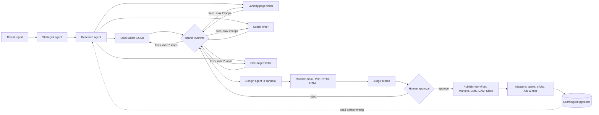
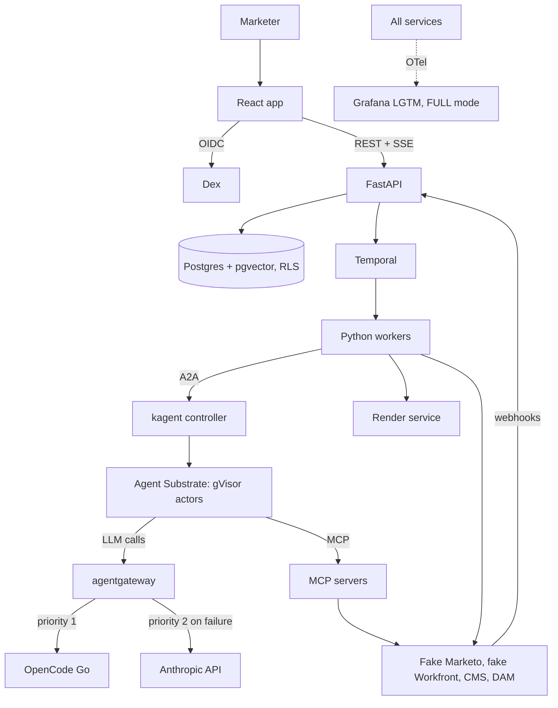

# Agentic Campaign Engine: spec

Status: plan. Date: 2026-10-09. User stories, module design, and test seams:
[spec, issue #18](https://github.com/dackota/agentic-campaign-engine/issues/18).

## What this is

A marketer drops in a threat report. A team of AI agents turns it into a full
campaign: emails with an A/B test, a landing page, social posts, a PDF
one-pager, and a sales deck. A human approves each piece. The engine then
publishes to the marketing stack and watches the results. What worked flows
back into the agents, so the next campaign starts smarter.

It runs end to end on a laptop with k3d. The only outside thing it needs is a
model key.

The company in the demo is **Acme Security**. It is made up. No real brand,
logo, or customer appears anywhere in this repo.

## Why it exists

Marketing teams want an agentic AI platform: agents that draft, people who
approve, and a loop that learns from results. This repo builds one end to end.
Each capability maps to a part of this repo that proves it. See
[What it does and where it is proven](#what-it-does-and-where-it-is-proven).

It follows [agent-golden-path](https://github.com/dackota/agent-golden-path),
which put agents into production on kagent 0.10. This repo uses kagent 1.x
(alpha), where agents run on Agent Substrate.

## Who reads what

| Reader | What they get |
|---|---|
| Marketing leadership | A 3 to 5 minute video. One campaign, start to finish, in plain words |
| Engineers | This spec, the README proof table, the ADRs, and the code |
| Anyone curious | `make up` on k3d |

## What it does and where it is proven

| Capability | Where it is proven | Slice |
|---|---|---|
| Build integrations (Workfront, Marketo, Docs, Slack, CMS, DAM) | Fake Marketo-shaped and Workfront-shaped services with REST, OAuth2, and webhooks. A CMS and an S3 asset store in the cluster. Real Slack and Google Docs by flag. Each one is also an MCP server | S5 |
| Orchestration layer: multi-agent pipelines, state, error recovery, parallel runs | A Temporal workflow that runs a campaign DAG. Parallel fan-out, retries, resume after a crash, review loops, approval gates | S3, S4 |
| Web UIs for non-technical users | React app: campaign dashboard, drag-and-drop workflow builder, approval inbox, live run view, in plain words with one consistent look | S3, S8, S15 |
| Production tooling: HTML email, PPTX, PDF, SVG, publishing | A render service with brand templates. One design agent makes social cards in a kagent sandbox | S7 |
| Analytics: dashboards, quality scoring, A/B tests, feedback loops | Simulated audience, webhooks, A/B stats, judge scores, and a pgvector "learnings" store the agents read | S9, S10 |
| Custom AI agents with MCP servers and enterprise systems | kagent AgentTemplates bound to our MCP servers. One custom Python agent as a stretch | S4, S5, S13 |
| Auth, permissions, multi-tenancy | Dex login (OIDC), 3 roles, Postgres row-level security, one namespace per team, token limits per team | S6 |
| CI/CD and reliability | Eval gate on every PR, nightly k3d run, signed images, alerts | S2, S10, S12 |
| Performance: caching, parallelism, LLM cost | Gateway failover, step cache, prompt caching, per-team concurrency limits, a dollar budget per campaign, a load test | S1, S11 |
| Explain it to marketing leadership | The video, the plain-language README, and ADRs that explain each trade-off | S14 |

## The pipeline

The default workflow template is "Threat report to campaign". Marketers can
change it in the workflow builder.

Rules:

- Agents read. The engine writes. No agent can send an email or publish a
  page. Writes are fixed engine steps that run only after a human approves.
- Every agent returns JSON that matches a schema. The engine checks it. A bad
  answer gets one repair try, then the step fails with a clear reason.
- Every fact in the copy must point to a line in the source report. The brand
  reviewer and the judge both check this.
- While a campaign waits for a human, its agents use no compute. Substrate
  snapshots them and wakes them in under a second when work comes back.

## Architecture

| Component | Job | Tech |
|---|---|---|
| Web | Dashboard, workflow builder, approvals, live run view | React, TypeScript, Vite, shadcn/ui, React Flow, SSE |
| API | Campaigns, workflows, approvals, webhooks, auth checks | Python, FastAPI, SQLAlchemy |
| Engine | Runs the campaign DAG durably | Temporal dev server, Python workers |
| Agents | Strategist, research, writers, reviewer, judge, design | kagent 1.x AgentTemplates on the Go harness |
| Agent runtime | Sandboxed, snapshotted agent sessions | Agent Substrate (gVisor) |
| LLM gateway | Holds keys, fails over, rate limits per team, logs tokens | agentgateway |
| Integrations | Marketing stack stand-ins, each with REST, OAuth2, webhooks, MCP | Python, FastAPI, MCP SDK |
| Render | Email HTML, PDF, PPTX, SVG from brand templates | MJML, reportlab (PDF), python-pptx |
| Data | App data, learnings vectors, metrics | One Postgres with pgvector, row-level security per team |
| Login | OIDC with demo users in 2 teams | Dex |
| Observability | Traces, metrics, logs, alerts (FULL mode) | OpenTelemetry, grafana/otel-lgtm |

## Decisions

Each line was decided in the planning session on 2026-10-09. Longer ADRs go
in `docs/decisions/` as each slice lands.

| # | Topic | Decision | Why |
|---|---|---|---|
| 1 | Story | Security campaign engine for made-up Acme Security | Matches the team's work and the company's world |
| 2 | Deliverable | Video + README proof table + runnable on k3d | Most readers will watch it, not run it |
| 3 | Timeline | Full build first, about 2 to 3 weeks | Every capability works before the demo is recorded |
| 4 | Orchestration | Our DAG engine on Temporal. Each step calls a kagent Agent over A2A | The orchestration layer is ours to build. kagent has no pipeline engine |
| 5 | k3d risk | Spike on day 1. Fix for up to 1 day and file upstream issues. Then fall back to kind | kagent 1.x is only tested on kind |
| 6 | Model | agentgateway with priority failover: OpenCode Go first, a pay-as-you-go Anthropic API key second | Cheap default, real failover story. A Claude login cannot sit behind a gateway |
| 7 | Agents | Declarative AgentTemplates on the Go harness. One custom Python agent as a stretch | The Go harness is stable and has structured output. Python wake-up crashes are a known risk |
| 8 | Integrations | Fakes by default, real Slack and Google Docs by flag | No outside accounts needed to run it |
| 9 | App stack | FastAPI + React/Vite | Python and TypeScript each get a clear job |
| 10 | Auth | Dex + Postgres row-level security + team namespaces | Real OIDC at about 30 MB of RAM |
| 11 | Rendering | Deterministic renderers + one sandbox design agent | Safe, testable output. Still shows kagent sandboxes |
| 12 | Analytics | Simulated audience + A/B stats + pgvector learnings (RAG) | A real feedback loop, and RAG is a bonus point |
| 13 | Evals | Our own eval harness with a baseline gate in CI | The goal is an eval framework, not an eval tool |
| 14 | Resources | Docker Desktop at 8 CPUs and 24 GB. `make up` core, `make up FULL=1` adds observability | The full stack will not fit in 14.6 GB |
| 15 | Deploy | Helm + Tilt + GHCR with digest pins. No Argo | kagent wants digests. Argo was already shown in the last repo |
| 16 | Order | Spike, walking skeleton, then widen one bullet per slice | The demo always works, so we can stop at any point |
| 17 | Repo | `dackota/agentic-campaign-engine`, private until S14 | |
| 18 | Plan home | This file + one GitHub issue per slice | Progress is visible. Agents can pick up issues |
| 19 | Test seams | Two seams: the Campaign API (fast depth with scripted agents, live depth on k3d) and the browser. Row-level security is the only team filter | Few seams keep tests stable while modules change. API tests then prove the database rule too |

Defaults chosen without a question:

- Observability is OpenTelemetry to grafana/otel-lgtm in FULL mode, with
  Grafana alert rules. Honeycomb export by flag.
- Temporal runs as the dev server with its own SQLite file on a volume. The app
  and pgvector share one Postgres. kagent and Substrate keep their own.
- Demo users: two teams (Demand Gen, Product Marketing) and three roles
  (owner, approver, viewer).

## Risks and open questions

The spike (S0) and the gateway slice (S1) answer these first.

| # | Question | If the answer is bad |
|---|---|---|
| 1 | Do Substrate's gVisor workers run inside k3d nodes on Docker Desktop (arm64)? | Fall back to kind, per decision 5 |
| 2 | Does k3s v1.37.1 accept the `certificates.k8s.io/v1beta1` runtime config and the pod certificate feature gates through k3d args? | Same as above |
| 3 | Does a Python BYO agent survive snapshot and wake-up? kagent's own script says it crashes with "Illegal instruction" | Keep all agents on the Go harness. File the bug upstream |
| 4 | Can agentgateway call OpenCode Go's chat-completions endpoint as an OpenAI provider, with our own user agent and an `x-opencode-session` header? | Put a small header proxy in front, or switch priority 1 to the Anthropic key |
| 5 | Does failover work across OpenAI-style and Anthropic-style providers in one priority list? | Use two OpenAI-style providers, or accept manual switching |
| 6 | How do we tie token use to one campaign? Trace context through kagent to the gateway, or usage data in the A2A task | Attribute per team only, from the gateway |
| 7 | OpenCode Go asks for "coding-agent-like" traffic. Marketing copy is not that | Watch for warnings. Keep the Anthropic key ready as priority 1 |
| 8 | kagent ships a new alpha every few days | Pin one alpha after the spike. Upgrade only on purpose |

## Slices

One GitHub issue per slice. Each slice ends with the demo still working end to
end.

| Milestone | Slice | Result |
|---|---|---|
| M0 Foundation | S0 Spike: kagent 1.x on k3d | One declarative agent answers over A2A on k3d. Versions pinned. Findings written down |
| | S1 LLM gateway with failover | Agents call agentgateway. OpenCode Go first, Anthropic on failure. Per-team token limits |
| | S2 Repo skeleton | Makefile, Helm chart, Tilt, CI for lint and unit tests, pre-commit |
| M1 Skeleton | S3 Walking skeleton | Brief form, Temporal workflow, one agent, one email, one approval click, one fake Marketo send, live status |
| M2 Widen | S4 Multi-agent DAG engine | All agents, parallel fan-out, retries, review loop, resume after a killed worker |
| | S5 Integrations as MCP servers | Fake Marketo and Workfront, CMS, DAM, real Slack and Docs by flag |
| | S6 Auth and multi-tenancy | Dex, roles, RLS, team namespaces, cross-team access denied at the database |
| | S7 Production tooling | Render service, brand templates, snapshot tests, sandbox design agent |
| | S8 Web UI | Workflow builder, approval inbox, dashboard, live run view |
| | S9 Analytics and feedback loop | Simulated audience, webhooks, A/B stats, learnings store, dashboards |
| | S10 Eval harness and CI gate | Golden briefs, hard checks, judge, baseline gate, nightly k3d run |
| | S11 Performance and cost | Step cache, prompt caching, concurrency limits, campaign budget, load test |
| | S12 Observability and alerting | OTel everywhere, Grafana dashboards, alert rules |
| | S13 Custom Python agent (stretch) | Research agent as a BYO Google ADK agent, if S0 says it survives wake-up |
| M3 Ship | S15 Marketer-ready UI and UX | One look, plain words on every screen, guided campaign, inbox, and builder screens, previews that render, a report-style dashboard, then the demo recorded again |
| | S14 Ship it | README proof table, ADRs, demo script, video, go public |

S0 comes first. S1 and S2 can run in either order. S4 to S13 can run in any
order once S3 works, but S8 (UI) needs S4 (engine) for its live run view.
S15 builds on S8 and comes before the S14 video, because the video is shown to
marketers.

## Run modes

| Command | What runs | Docker RAM |
|---|---|---|
| `make up` | k3d, Substrate, kagent, agentgateway, Temporal, Postgres, Dex, API, web, render, fakes, MCP servers | about 12 GB (to be measured) |
| `make up FULL=1` | All of the above plus OTel collector, Grafana LGTM, and real integrations if tokens are set | about 16 GB (to be measured) |

Needs: Docker Desktop with 8 CPUs and 24 GB, k3d, kubectl, Helm, Tilt, Go,
Python with uv, Node with pnpm, and one model key.

## Path to AWS

Not built. Written down so the design holds up.

| Here | On AWS |
|---|---|
| k3d | EKS, with gVisor or microVM node groups for Substrate |
| Postgres in the cluster | RDS for PostgreSQL with pgvector |
| S3-like asset store | S3 |
| Temporal dev server | Temporal Cloud or a self-hosted Temporal cluster |
| Dex | The company IdP (Okta, Entra) |
| Secrets in Kubernetes | Secrets Manager through External Secrets Operator |
| Anthropic as failover | Amazon Bedrock as a third priority group |
| grafana/otel-lgtm | The company observability stack |

## Sources

Every page read during planning, and what each one told us, is in
[docs/sources.md](docs/sources.md).

## Out of scope

- Real Marketo and Workfront. They have no free accounts. The fakes copy
  their API shape.
- Real email delivery. The fake Marketo "sends" to a simulated audience.
- A production security review. The guard rails here are real but not audited.
- Scaling past one laptop. The load test proves the limits work, not the size.
