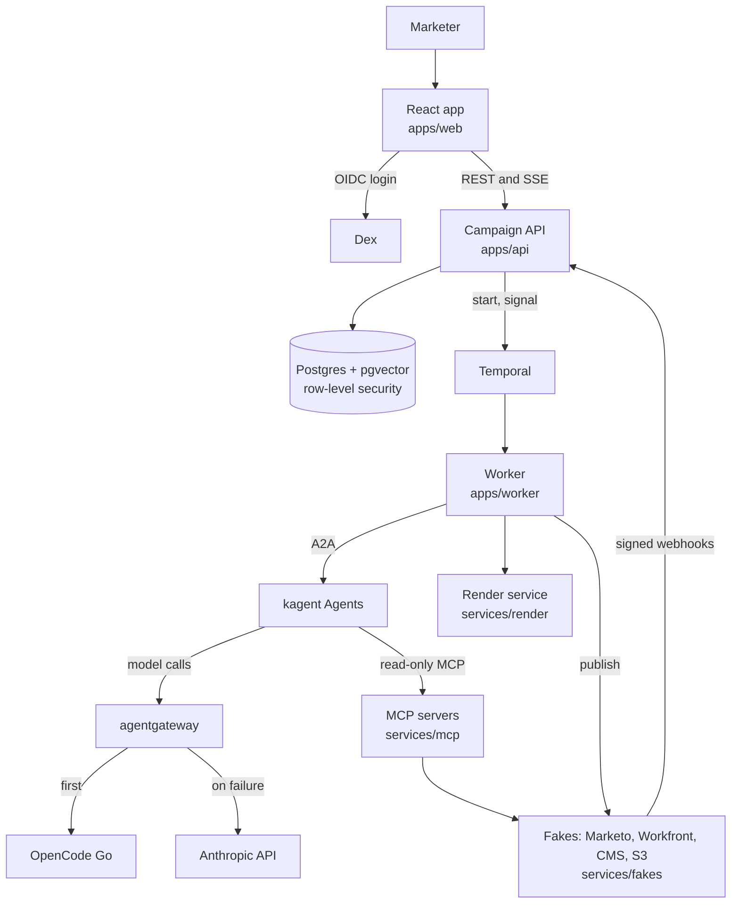
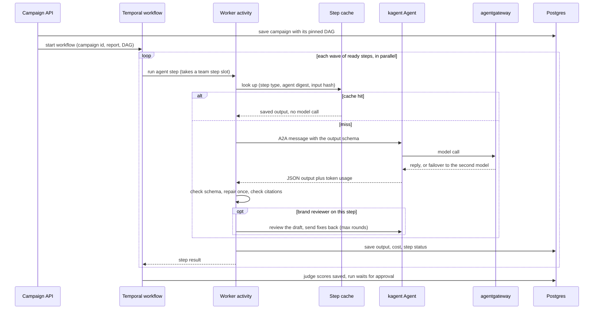
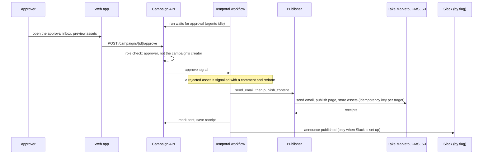
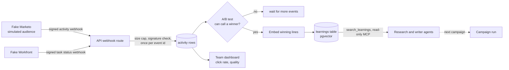
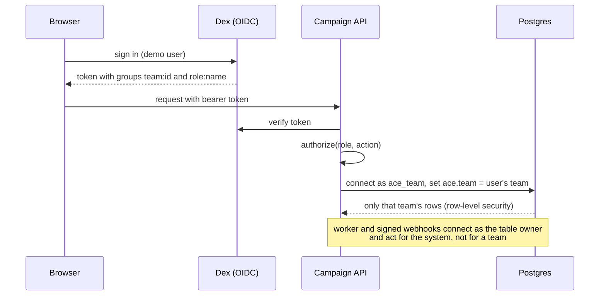

# Architecture

How a campaign moves through the engine. Each diagram follows the code on this branch; the
file names under each one are where to read the real thing. The component list and the
reasons for each choice are in [SPEC.md](../SPEC.md) and the [decisions index](decisions/README.md).

## The parts

## Campaign run

The API pins the workflow DAG to the run and starts one Temporal workflow. The workflow
starts every ready step of a wave at the same time. An agent step asks one kagent Agent over
A2A, checks the reply against the step's JSON Schema (one repair try), and saves it. The
brand reviewer can send a writer back for fixes, up to a set number of rounds. The judge
scores every asset; a score under the floor stops the run and names the asset.

- DAG rules: `apps/engine/ace_engine/dag.py`. Workflow: `apps/worker/campaign_worker/workflow.py`.
- Agent call and schema check: `apps/engine/ace_engine/invoker.py`. Step cache:
  `apps/engine/ace_engine/step_cache.py`. Team step slots: `apps/engine/ace_engine/limits.py`.
- A failed step stops the run with its reason. The owner's retry signal re-runs the
  unfinished steps of that wave. A spent budget pauses the step until the owner raises it.
- Live progress reaches the browser as server-sent events from `GET /campaigns/{id}/events`.

## Approval and publish

Agents read. The engine writes. A publish step runs only after an approval step, and the API
rejects a workflow where it would not.

- Role rules: `apps/api/campaign_api/auth.py`. Publisher: `apps/worker/campaign_worker/publisher.py`.
- Slack notices and the Google Doc export: `apps/worker/campaign_worker/notify.py`.

## Webhooks and learnings

The fake Marketo plays a simulated audience. It posts signed activity events back to the API.
The API counts opens and clicks per variant, and when the A/B test can call a winner it keeps
the winning lines as a learning. The research and writer agents search learnings before they
write.

- Webhooks: `apps/api/campaign_api/webhook_routes.py`. Winner rule: `apps/api/campaign_api/ab_result.py`.
- Learnings store: `apps/engine/ace_engine/learnings.py`; the tool the agents call is in
  `services/mcp/ace_mcp/learnings.py`.
- Each campaign is one OpenTelemetry trace; later requests and webhooks join it
  ([one-trace-per-campaign.md](decisions/one-trace-per-campaign.md)).

## Auth and team isolation

Dex issues the token. The API reads the team and the role from the token and opens the
database as that team. The database, not the API's queries, filters rows.

- Token and roles: `apps/api/campaign_api/auth.py`. Row-level security: `apps/engine/ace_engine/row_security.py`.
- Each team also gets its own namespace, model config and token limit
  ([team-isolation.md](decisions/team-isolation.md), `agents/teams/`).
- Why one issuer URL serves the browser and the pods:
  [dex-issuer-on-cluster.md](decisions/dex-issuer-on-cluster.md).
